# 🚀 FireBridge AI Ultra

> **Next-Generation Multi-Modal AI Viewing Assistant & Offline-First Mobile Remote for Amazon Fire OS**  
> Built with Kotlin, Java-WebSocket, ZXing, Web Speech API, and AWS Bedrock (`amazon.nova-lite-v1:0` & `anthropic.claude-3-5-sonnet-20241022-v2:0`).

---

## 🌟 Executive Summary

**FireBridge AI Ultra** reimagines the Fire TV interaction model. Instead of tedious on-screen keyboard typing or relying on traditional remotes, FireBridge AI Ultra turns any television running Amazon Fire OS into an intelligent, contextual, multi-modal viewing hub.

1. **Zero App Downloads**: A dynamic, high-resolution QR code is rendered on the TV screen inside a glowing neon frame. Scanning the code with any iOS or Android camera instantly launches a dark glassmorphic Progressive Web Remote hosted directly from the Fire TV's embedded server.
2. **Dual-Mode Controller**: Switchable interface tabs between a **Tactile D-Pad** (with micro-haptic feedback), a **Gesture Swipe Touchpad** (full-screen touch surface with visual particle trails), and an **AI Assistant Hub**.
3. **Mobile Voice Dictation**: Web Speech API integration allows viewers to tap the pulsing cyan microphone button and dictate natural speech queries with real-time text transcription.
4. **AWS Bedrock Viewing Assistant**: One-tap AI preset pills (*"Who is this actor?"*, *"Summarize last 10 mins"*, *"Explain plot twist"*, *"Kid-Friendly rating check"*) send instant queries to AWS Bedrock, rendering smooth slide-in ambient HUD cards on the television screen.

---

## 🏗️ Architecture & Protocol Design

```mermaid
sequenceDiagram
    autonumber
    actor User as TV Viewer (Smartphone)
    participant TV_UI as Fire TV App (MainActivity)
    participant Server as FireBridge Server (:8080)
    participant AWS as AWS Bedrock (Nova / Claude)

    TV_UI->>Server: Start Dual Server (HTTP & WebSocket on :8080)
    TV_UI->>TV_UI: Generate QR Code (http://<IP>:8080/remote.html)
    User->>Server: Scan QR & Load remote.html (HTTP GET)
    Server-->>User: Serve Glassmorphic PWA Remote
    User->>Server: Establish WebSocket Connection (ws://<IP>:8080)
    Server->>TV_UI: Device Connected (Increment Counter)
    
    rect rgb(22, 31, 51)
        Note over User,TV_UI: Tactile & Gesture Navigation
        User->>Server: { "type": "KEY", "value": "SELECT" }
        Server->>TV_UI: KeyCommandExecutor.executeKey("SELECT")
    end

    rect rgb(30, 41, 59)
        Note over User,AWS: Multi-Modal AI Voice Query
        User->>User: Web Speech API transcribes voice
        User->>Server: { "type": "AI_PROMPT", "value": "Who is this actor?" }
        Server->>TV_UI: Trigger Ambient HUD (Slide Up & Thinking)
        TV_UI->>AWS: Invoke Bedrock (Nova Lite / Claude 3.5 Sonnet)
        AWS-->>TV_UI: Formatted Cinematic Intelligence
        TV_UI->>TV_UI: Render Floating Glass HUD Card
        TV_UI->>Server: Broadcast AI Response
        Server-->>User: Render Mobile Response Viewer Card
    end
```



---

## 📱 Feature Highlights

### 1. Mobile Voice Input (Web Speech API)
- Directly integrated into `app/src/main/assets/remote.html`.
- Uses `webkitSpeechRecognition` with continuous interim transcription preview.
- Pulsing cyan neon microphone with animated radar waves when listening.
- Fallback text input field with "Ask Bedrock" button for environments where speech dictation is unavailable.

### 2. Dual-Mode Remote Controls
- **Tactile D-Pad**: Directional wings (`UP`, `DOWN`, `LEFT`, `RIGHT`) and large center `SELECT` button, accompanied by `BACK`, `HOME`, and `MENU` action buttons.
- **Swipe Touchpad**: Full-screen gesture area tracking `touchstart`, `touchmove`, and `touchend`. Translates directional swipes into `DPAD` commands and single taps into `SELECT`. Includes a glowing finger cursor trail and directional badge flash.
- **Haptic Feedback**: Emits `navigator.vibrate(12)` on every button tap and gesture swipe for a tactile remote feel.

### 3. Media & Quick Action Bar
- Dedicated hardware-style controls docked at the bottom of the remote:
  * `REWIND` (10s)
  * `PLAY / PAUSE` (with glowing gradient accent)
  * `FAST FORWARD` (10s)
  * `VOL -`, `MUTE`, `VOL +` (directly interfacing with Android `AudioManager`)
  * One-tap App Launchers: YouTube, Netflix, Prime Video, and Fire TV Settings.

### 4. AI Preset Prompts
- Quick-action pills for instant television viewing intelligence:
  * 🎭 **"Who is this actor?"**
  * ⏱️ **"Summarize last 10 mins"**
  * 🌀 **"Explain plot twist"**
  * 🛡️ **"Kid-Friendly rating check"**
  * 🎵 **"What song is playing?"**
  * 🔍 **"Trivia & Easter eggs"**

### 5. Ambient Glassmorphism TV HUD (`activity_main.xml`)
- **Background**: Deep slate/dark midnight gradient (`#0F172A` to `#020617`).
- **Glassmorphism Cards**: Semi-transparent background (`#B31E293B`), subtle 1dp border (`#334155`), rounded corners (`24dp`), and soft drop shadows.
- **Left Panel**: High-resolution QR code inside a glowing neon frame (`#38BDF8`), connection URL, and quick 3-step setup guide.
- **Right Panel**: Live status dashboard displaying server port, connected device counter, live clock & date, and recent command telemetry.
- **Floating AI HUD Card**: Smoothly slides in from the bottom-right (`fadeIn` + `slideUp`) when AWS Bedrock sends a response, displaying the user's prompt, formatted AI analysis, model metadata, and auto-dismiss countdown.

---

## 🛠️ Technical Stack & Dependencies

| Component | Technology | Version / Specification |
| :--- | :--- | :--- |
| **Platform** | Amazon Fire OS / Android TV | `minSdk = 24`, `targetSdk = 34` |
| **Language** | Kotlin & Modern ES6 JavaScript | Kotlin 1.9.22 / Java 17 |
| **Embedded Server** | Java-WebSocket & Multiplexer | `org.java-websocket:Java-WebSocket:1.5.4` |
| **QR Code Engine** | ZXing Core & Embedded | `com.google.zxing:core:3.5.3` |
| **AI Inference** | AWS SDK for Kotlin (Bedrock Runtime) | `aws.sdk.kotlin:bedrockruntime:1.0.0` |
| **Bedrock Models** | Amazon Nova Lite / Claude 3.5 Sonnet | `amazon.nova-lite-v1:0` / `claude-3-5-sonnet` |
| **Concurrency** | Kotlin Coroutines & Flow | `kotlinx-coroutines-android:1.8.0` |

---

## 🔌 WebSocket JSON Protocol Specification

### 1. Key Command (`Client -> Server`)
```json
{
  "type": "KEY",
  "value": "UP" | "DOWN" | "LEFT" | "RIGHT" | "SELECT" | "BACK" | "HOME" | "PLAY_PAUSE" | "REWIND" | "FAST_FORWARD" | "VOL_UP" | "VOL_DOWN" | "MUTE"
}
```

### 2. Swipe Gesture (`Client -> Server`)
```json
{
  "type": "SWIPE",
  "direction": "UP" | "DOWN" | "LEFT" | "RIGHT"
}
```

### 3. AI Query (`Client -> Server`)
```json
{
  "type": "AI_PROMPT",
  "value": "Who is this actor and what awards have they won?"
}
```

### 4. App Launch (`Client -> Server`)
```json
{
  "type": "LAUNCH_APP",
  "package": "com.amazon.firetv.youtube"
}
```

### 5. AI Response (`Server -> Client Broadcast`)
```json
{
  "type": "AI_RESPONSE",
  "prompt": "Who is this actor?",
  "response": "Lead Actor: Cillian Murphy (as J. Robert Oppenheimer)...",
  "model": "amazon.nova-lite-v1:0",
  "timestamp": 1729600000000
}
```

### 6. Client Count Telemetry (`Server -> Client Broadcast`)
```json
{
  "type": "CLIENT_COUNT",
  "count": 2
}
```

---

## 🚀 Building & Running in Android Studio

### Prerequisites
- **Android Studio Hedgehog / Iguana / Jellyfish** (or later) with JDK 17 configured.
- Amazon Fire TV Stick / Fire TV Cube connected via ADB over Wi-Fi, or Android TV Emulator.

### Step-by-Step Setup
1. **Open Project**: Launch Android Studio and select **Open**, navigating to `s:\amazon hackathon`.
2. **Gradle Sync**: Android Studio will automatically sync dependencies (`build.gradle.kts` and `app/build.gradle.kts`).
3. **AWS Bedrock Configuration (Optional)**:
   - To connect to live AWS Bedrock, configure your AWS credentials in your environment or AWS profile:
     ```bash
     export AWS_ACCESS_KEY_ID="your-access-key"
     export AWS_SECRET_ACCESS_KEY="your-secret-key"
     export AWS_REGION="us-east-1"
     ```
   - *Note*: If AWS credentials are not set, FireBridge AI Ultra automatically activates **Demo / Simulation Mode**, providing rich contextual TV viewing assistant responses out-of-the-box!
4. **Deploy to Fire TV**:
   - Enable **Developer Options** and **ADB Debugging** on your Fire TV (`Settings > My Fire TV > Developer Options`).
   - Connect via ADB:
     ```bash
     adb connect <FIRE_TV_IP>:5555
     ```
   - Click **Run 'app'** in Android Studio.

---

## 📁 Repository Directory Structure

```
s:\amazon hackathon\
├── build.gradle.kts                       # Root Gradle build script
├── settings.gradle.kts                    # Project modules and repository configuration
├── gradle.properties                     # JVM arguments and AndroidX flags
├── gradlew / gradlew.bat                 # Unix and Windows Gradle wrappers
├── README.md                             # Complete project documentation
├── gradle/
│   └── wrapper/
│       └── gradle-wrapper.properties     # Gradle 8.4 binary distribution
└── app/
    ├── build.gradle.kts                  # App module dependencies, SDK versions, packaging
    ├── proguard-rules.pro                # ProGuard rules for AWS SDK and WebSockets
    └── src/
        └── main/
            ├── AndroidManifest.xml       # Leanback launcher, Fire TV features, permissions
            ├── assets/
            │   └── remote.html           # Dark luxury glassmorphic mobile web controller
            ├── java/
            │   └── com/
            │       └── firebridge/
            │           └── aiultra/
            │               ├── MainActivity.kt        # QR code, HUD animations, clock, server binding
            │               ├── FireBridgeServer.kt    # Dual HTTP & WebSocket multiplexer on :8080
            │               ├── BedrockService.kt      # AWS Bedrock Client (Nova Lite / Claude 3.5 Sonnet)
            │               ├── KeyCommandExecutor.kt  # Fire OS key injection & AudioManager controls
            │               └── NetworkUtils.kt        # Local IP discovery & pairing URL generator
            └── res/
                ├── anim/
                │   ├── slide_up_fade_in.xml           # TV HUD card entrance animation
                │   ├── slide_down_fade_out.xml         # TV HUD card exit animation
                │   └── pulse_glow.xml                 # Pulsing status LED animation
                ├── drawable/
                │   ├── bg_tv_gradient.xml             # Deep slate/midnight TV background
                │   ├── bg_glass_card.xml              # Translucent 70% slate glassmorphism
                │   ├── bg_glass_card_neon.xml         # Glowing neon cyan glass card
                │   ├── bg_qr_frame.xml                # High-contrast glowing QR frame
                │   ├── bg_status_badge.xml            # Pill-shaped telemetry status badges
                │   ├── bg_ai_hud.xml                  # Floating ambient HUD card background
                │   ├── ic_fire_bridge.xml             # FireBridge vector branding logo
                │   ├── ic_wifi.xml                    # Wi-Fi network vector icon
                │   ├── ic_qr_code.xml                 # QR pairing vector icon
                │   ├── ic_remote.xml                  # Mobile remote vector icon
                │   └── ic_ai_sparkle.xml              # AI sparkle vector icon
                ├── layout/
                │   └── activity_main.xml              # Ambient Glassmorphism TV HUD 1080p layout
                ├── values/
                │   ├── colors.xml                     # Dark midnight slate, glass, and neon palette
                │   ├── strings.xml                    # Application string resources
                │   └── themes.xml                     # Dark Leanback theme for Fire TV
                └── mipmap-anydpi-v26/
                    ├── ic_launcher.xml                # Adaptive app launcher icon
                    └── ic_launcher_round.xml          # Adaptive round app launcher icon
```

---

## 🏆 Hackathon Evaluation Checklist

- [x] **Complete, Plug-and-Play Kotlin Codebase** in `s:\amazon hackathon` ready for Android Studio.
- [x] **Embedded Server on Port 8080** serving both static HTTP `remote.html` and WebSocket on the same port.
- [x] **Mobile Voice Input** with Web Speech API integration, visual radar pulses, and real-time transcription.
- [x] **Dual-Mode Switchable Remote** (Tactile D-Pad, Touchpad swipe gesture canvas, and AI Hub).
- [x] **Hardware Media & Quick Action Bar** (Play/Pause, Rewind, Fast Forward, Volume Up/Down, Mute, App Launchers).
- [x] **AI Preset Prompts** (*"Who is this actor?"*, *"Summarize last 10 mins"*, *"Explain plot twist"*, *"Kid-Friendly rating check"*).
- [x] **Ambient Glassmorphism TV HUD** with deep midnight gradient, glowing QR code frame, live digital clock, and smooth slide-in animated cards for AWS Bedrock responses.
- [x] **AWS Bedrock Runtime Client** supporting `amazon.nova-lite-v1:0` and `anthropic.claude-3-5-sonnet-20241022-v2:0` with intelligent fallback demo mode.
